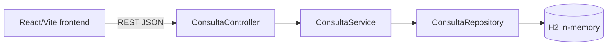

# sistema-agendamento-consultas

**English** · [Português (Brasil)](README.md)

    

## What it is

**A medical appointment scheduling system** (fullstack): a **Spring Boot REST API** to create, list and cancel appointments (with business validations), plus a **React + TypeScript + Vite web UI** that consumes the API. Appointments live in an in-memory **H2** database (via Spring Data JPA).

## Status

A working fullstack app (prototype/lab). API tests passing (27 tests).

## Features

- **REST API** (`ConsultaController`):
  - `POST /consultas` — schedules an appointment (validates name, type, future date).
  - `GET /consultas` — lists appointments.
  - `DELETE /consultas/{id}` — cancels an appointment (409 if already cancelled).
- **Business rules** (`ConsultaService`): date/time cannot be in the past; name and type are required; cannot cancel an already-cancelled appointment.
- **Model** (`Consulta`): `id`, `pacienteNome`, `tipo`, `dataHora`, `status` (`AGENDADA`/`CANCELADA`), `criadoEm`.
- **Error handling** (`GlobalExceptionHandler`): proper HTTP responses (`400`, `404`, `409`).
- **React frontend** (Vite) that consumes the API.

## Architecture

A **Spring Boot 3** backend with controller → service → repository layers (Spring Data JPA) over **in-memory H2**. A **React + Vite** frontend in `frontend/`. Communication via a REST JSON API.



## Stack

- Backend: Java 21, Spring Boot 3, Spring Data JPA, H2, Maven
- Frontend: React 18, TypeScript, Vite

## Repository layout

```
sistema-agendamento-consultas/
├── pom.xml · src/                # Spring Boot backend
│   └── main/java/com/kelvinoliveira/sistemaagendamentoconsultas/
│       ├── controller/ · service/ · repository/
│       ├── model/ · dto/ · exception/
│       └── SistemaAgendamentoConsultasApplication.java
├── frontend/                     # React + Vite UI
└── README.md
```

## Prerequisites and installation

- JDK 21 and Maven 3.9+ (backend)
- Node.js ≥ 18 (frontend)

```bash
# backend
mvn spring-boot:run

# frontend
cd frontend && npm install && npm run dev
```

## How to run

```bash
# API at http://localhost:8080/consultas
curl -X POST http://localhost:8080/consultas \
  -H "Content-Type: application/json" \
  -d '{"pacienteNome":"Maria","tipo":"Cardiologia","dataHora":"2026-12-01T10:00:00"}'
```

## Tests and quality

Real command (verified by the agent):

```bash
mvn test
# BUILD SUCCESS — 27 tests passing (0 failures, 0 errors)
```
CI covers the backend test suite.

## Technical decisions and trade-offs

- **In-memory H2**: no database setup, ideal for a lab; data is lost on restart.
- **Spring Data JPA + service validations**: clear, testable business rules in the service layer.
- **Separate frontend** (React/Vite): decouples the UI from the API.

## Known limitations and roadmap

- In-memory database (no persistence across runs); no authentication/authorization.
- Basic frontend (no free-slot booking per professional).

## Development process

An individual project by Kelvin Oliveira, built with orchestrated AI agents and reviewed by the author. The API, the validations and the review are the author's.

## License and author

MIT — Copyright (c) 2026 Kelvin Rebelo de Oliveira.

**Author**: [Kelvin Oliveira](https://github.com/KelvinOliveiraCode) · [Portfolio](https://kelvinoliveiracode.github.io/portfolio/)
