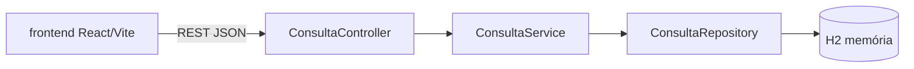

# sistema-agendamento-consultas

[English](README.en.md) · **Português (Brasil)**

    

## O que é

**Sistema de agendamento de consultas** (fullstack): uma **API REST em Spring Boot** para criar, listar e cancelar consultas médicas (com validações de negócio), mais uma **interface web em React + TypeScript + Vite** que consome a API. As consultas ficam em banco **H2** em memória (via Spring Data JPA).

## Status

Aplicação fullstack funcional (protótipo/laboratório). Testes da API passando (27 testes).

## Funcionalidades

- **API REST** (`ConsultaController`):
  - `POST /consultas` — agenda uma consulta (valida nome, tipo, data futura).
  - `GET /consultas` — lista consultas.
  - `DELETE /consultas/{id}` — cancela uma consulta (409 se já cancelada).
- **Regras de negócio** (`ConsultaService`): data/hora não pode ser no passado; nome e tipo obrigatórios; não cancela consulta já cancelada.
- **Modelo** (`Consulta`): `id`, `pacienteNome`, `tipo`, `dataHora`, `status` (`AGENDADA`/`CANCELADA`), `criadoEm`.
- **Tratamento de erros** (`GlobalExceptionHandler`): respostas HTTP adequadas (`400`, `404`, `409`).
- **Frontend** em React (Vite) que consome a API.

## Arquitetura

Backend em **Spring Boot 3** com camadas controller → service → repository (Spring Data JPA) sobre **H2 em memória**. Frontend **React + Vite** em `frontend/`. Comunicação via API REST em JSON.



## Stack

- Backend: Java 21, Spring Boot 3, Spring Data JPA, H2, Maven
- Frontend: React 18, TypeScript, Vite

## Estrutura do repositório

```
sistema-agendamento-consultas/
├── pom.xml · src/                # backend Spring Boot
│   └── main/java/com/kelvinoliveira/sistemaagendamentoconsultas/
│       ├── controller/ · service/ · repository/
│       ├── model/ · dto/ · exception/
│       └── SistemaAgendamentoConsultasApplication.java
├── frontend/                     # UI React + Vite
└── README.md
```

## Pré-requisitos e instalação

- JDK 21 e Maven 3.9+ (backend)
- Node.js ≥ 18 (frontend)

```bash
# backend
mvn spring-boot:run

# frontend
cd frontend && npm install && npm run dev
```

## Como executar

```bash
# API em http://localhost:8080/consultas
curl -X POST http://localhost:8080/consultas \
  -H "Content-Type: application/json" \
  -d '{"pacienteNome":"Maria","tipo":"Cardiologia","dataHora":"2026-12-01T10:00:00"}'
```

## Testes e qualidade

Comando real (verificado pelo agente):

```bash
mvn test
# BUILD SUCCESS — 27 testes passando (0 falhas, 0 erros)
```
CI cobre a suite de testes do backend.

## Decisões técnicas e trade-offs

- **H2 em memória**: sem configuração de banco, ideal para laboratório; dados se perdem ao reiniciar.
- **Spring Data JPA + validações no service**: regras de negócio claras e testáveis na camada de serviço.
- **Frontend separado** (React/Vite): desacopla UI da API.

## Limitações conhecidas e roadmap

- Banco em memória (sem persistência entre execuções); sem autenticação/autorização.
- Frontend básico (sem agendamento de slots/livres por profissional).

## Processo de desenvolvimento

Projeto individual de Kelvin Oliveira, construído com agentes de IA orquestrados e revisado pelo autor. A API, as validações e a revisão são do autor.

## Licença e autor

MIT — Copyright (c) 2026 Kelvin Rebelo de Oliveira.

**Autor**: [Kelvin Oliveira](https://github.com/KelvinOliveiraCode) · [Portfólio](https://kelvinoliveiracode.github.io/portfolio/)
